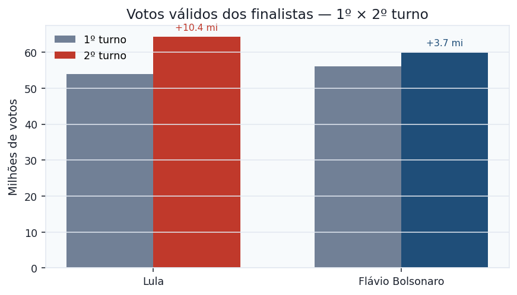
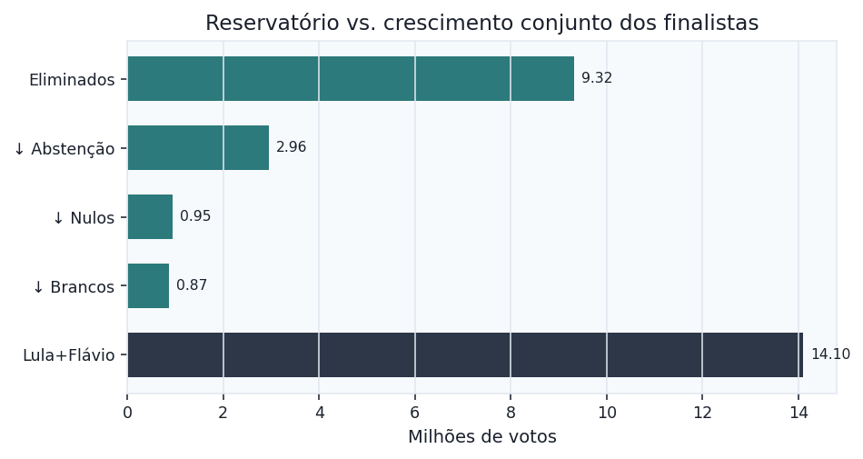
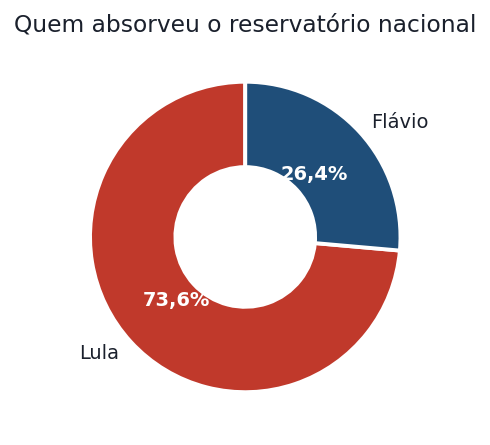
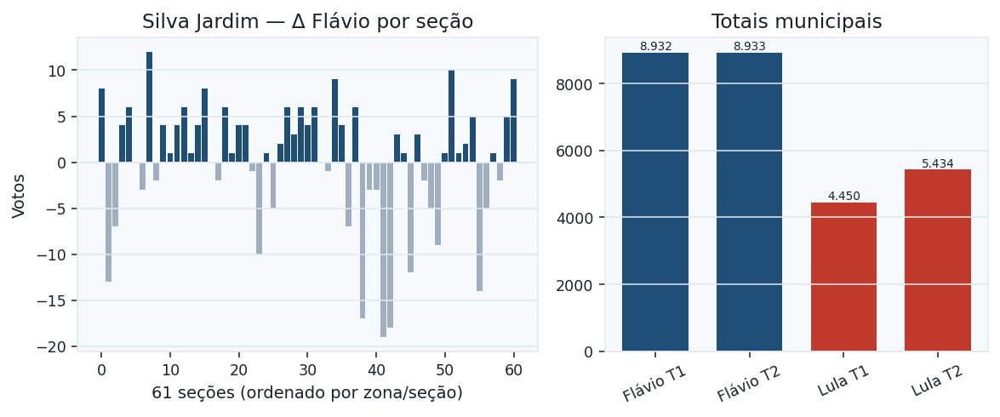
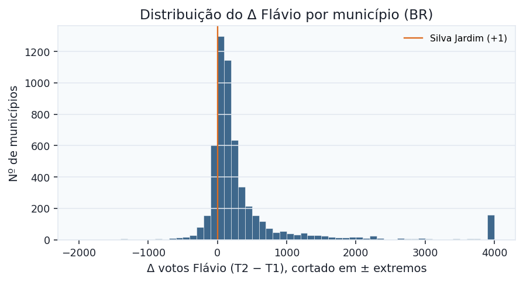
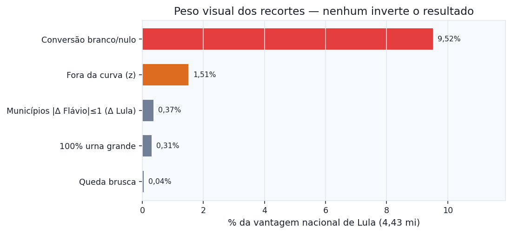

# Dashboard — Presidente 2026 (1º → 2º turno)

Versão visual e compacta. Texto completo: [`resumo.md`](resumo.md). Fonte: arquivos oficiais do TSE (votação e detalhe por seção).

## Números-chave

| Indicador | Valor |
| --- | ---: |
| Crescimento Lula | +10.376.694 |
| Crescimento Flávio | +3.721.538 |
| Crescimento conjunto | +14.098.232 |
| Reservatório (eliminados + abst. + nulo + branco) | 14.098.262 |
| Vantagem final Lula | 4.430.191 |
| Voto sem origem (poço da seção) | **0** |
| Seções pareadas | 499.205 |
| Seções em que os dois subiram | 393.414 (78,8%) |

## Conta nacional

| Item | Variação T1→T2 |
| --- | ---: |
| Outros candidatos | −9.321.993 |
| Abstenções | −2.960.269 |
| Nulos | −945.698 |
| Brancos | −870.302 |
| **Reservatório** | **14.098.262** |
| **Lula + Flávio** | **+14.098.232** |

Diferença residual: **30** votos (seções não pareadas / cadastro).

## Destino do reservatório

| Finalista | Absorção | Votos |
| --- | ---: | ---: |
| Lula | 73,6% | 10.376.694 |
| Flávio | 26,4% | 3.721.538 |

Flávio recuou em **82.180** seções (**383.008** votos). No agregado nacional, ainda assim cresceu.

## Silva Jardim/RJ — o caso que circula

| | 1º turno | 2º turno | Δ |
| --- | ---: | ---: | ---: |
| Flávio | 8.932 | 8.933 | +1 |
| Lula | 4.450 | 5.434 | +984 |
| Reservatório municipal | | | 982 |
| Seções Flávio ↑ / ↓ / = | | | 36 / 22 / 3 |

**Leitura rápida:** o +1 é saldo (+161 e −160 nas urnas). O salto de Lula cabe no reservatório. Municípios BR com \|Δ Flávio\| ≤ 1: **35** (~1 em 159) — não é Mega-Sena.

| Recorte municipal | N | Δ Lula | Reservatório |
| --- | ---: | ---: | ---: |
| \|Δ Flávio\| ≤ 1 (BR+ZZ) | 55 | +16.428 | 16.420 |
| Flávio caiu | 950 | +486.960 | 352.604 |
| Flávio subiu | 4.747 | +9.887.367 | 13.743.261 |

## Peso dos recortes na vantagem nacional

| Recorte | Seções / municípios | Peso na margem |
| --- | ---: | ---: |
| Conversão branco/nulo | 3.974 seções | 9,52% |
| Fora da curva (z) | 1.533 seções | 1,51% |
| Municípios \|Δ Flávio\|≤1 (Δ Lula) | 55 | 0,37% |
| 100% urna grande | 67 seções | 0,31% |
| Queda brusca | 17 seções | 0,042% |
| **Vantagem nacional** | | **4.430.191** |

## O que esta apuração vê × o que não vê

| Testa | Resultado |
| --- | --- |
| Voto sem origem (poço) | **0** casos |
| Conta aptos / comparecimento | sem quebra; 2 comparecimentos 100% em urna grande |
| Queda brusca | 17 seções |
| 100% urna grande | 67 seções |

| Não testa | Por quê |
| --- | --- |
| Troca A→B que preserva o total | Indistinguível de eleitor que mudou de lado |
| BU ≠ CSV | Este repo não lê Boletim de Urna |
| Software da urna se o BU bate | Fora do CSV público |
| Identidade / cadastro fantasma estável | Outras bases |

## Fluxo da cadeia × onde olhamos

Próximo passo se a dúvida for além do CSV: conferir o **Boletim de Urna** das seções já listadas em `flags_100pct_grandes.csv` e `flags_queda_brusca.csv`.

Arquivos: [`resumo.md`](resumo.md) · [`municipios_variacao.csv`](municipios_variacao.csv) · `flags_*.csv`
